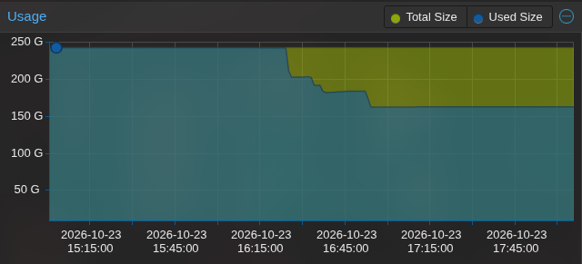

today i found myself in quite of a pinch. my 256gb boot ssd hosts all of my proxmox machines, and it ran out of storage for the 100th time!

usually i was able to just delete a few things and call it a day, but this time, there was nothing to delete. surprisingly though, i didn't enable "Discard" on the proxmox disks and i assume that the files that were deleted before weren't marked by the filesystem as so, so it never showed up as "free storage" to proxmox.  
after running `sudo fstrim -av` on every virtual machine, i found myself with this hidden storage i actually 

nothing much else to say. have a good day!